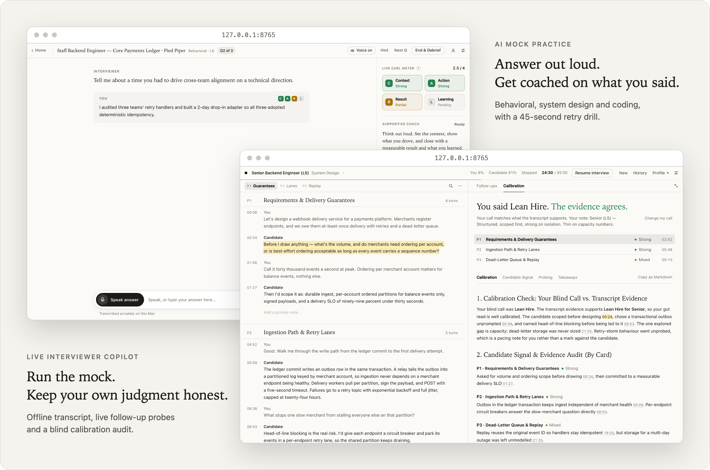
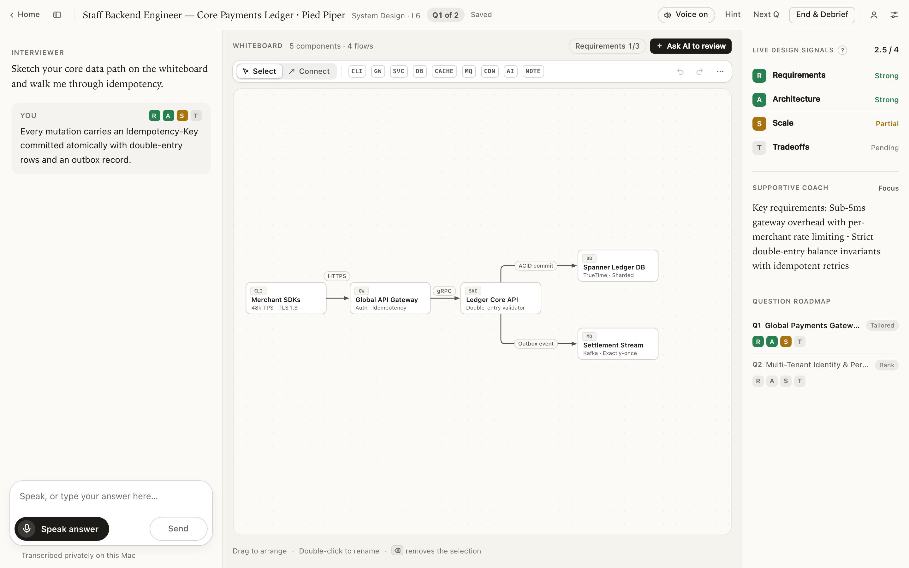
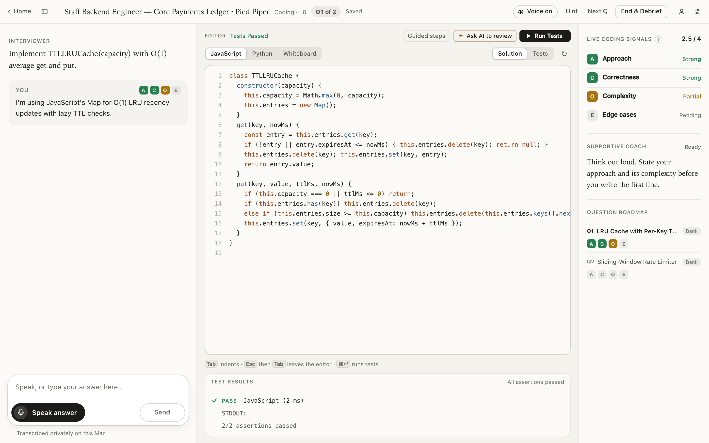
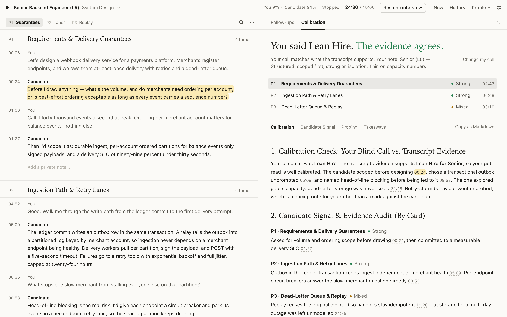

<p align="center">
  <picture>
    <source media="(prefers-color-scheme: dark)" srcset="docs/assets/wordmark-on-dark.svg">
    <source media="(prefers-color-scheme: light)" srcset="docs/assets/wordmark-on-light.svg">
    
  </picture>
</p>

<p align="center">
  <b>Local-first mock interview studio for Apple Silicon.</b><br>
  Practice the interview out loud. Then run one for someone else.
</p>

<p align="center">
  <a href="https://mockery.studio"><b>mockery.studio</b></a> · <code>v0.2.5</code> · macOS · Apple Silicon · <a href="LICENSE">MIT</a>
</p>

<p align="center">
  <picture>
    <source media="(prefers-color-scheme: dark)" srcset="docs/assets/hero-dark.png">
    <source media="(prefers-color-scheme: light)" srcset="docs/assets/hero-light.png">
    
  </picture>
</p>

```bash
curl -fsSL https://raw.githubusercontent.com/manthedan/mockery/main/install.sh | sh
```

Two modes, one local-first studio on your Mac. Speech recognition, speaker diarization, neural interviewer voices, resume PII redaction, and sandboxed code execution all run on Apple Silicon. The only thing that can ever leave your machine is text—and only to a model you choose.

## Two modes

### AI Mock Practice: you're the candidate

An AI interviewer tuned to your redacted resume and target role. It listens, probes, and coaches every round.

- **Voice-first behavioral.** Answer out loud to a local neural voice (Kokoro or Phonon, or built-in macOS speech) while a live CARL meter tracks Context, Action, Result, and Learning in real time.
- **Debrief and 45-second retry.** Get a question-by-question breakdown and concrete reframe, then re-deliver your weakest answer in one timed 45-second drill while the feedback is fresh.
- **System design whiteboard.** Sketch clients, gateways, services, caches, stores, and queues on an interactive SVG dot-grid canvas. The interviewer inspects your diagram and probes the trade-offs in what you actually drew.
- **Coding studio.** Write and run real tests in sandboxed Web Workers—JavaScript built in, Python completely offline through a local Pyodide pack.
- **Resume privacy redaction.** Rampart detects names, employers, emails, phone numbers, and links on-device and swaps them for neutral placeholders. Flip any detail in one click—the preview on screen is the only version a cloud model ever sees.

### Live Interviewer Copilot: you're the interviewer

A quiet second pair of ears when you run a mock for a friend or teammate—on Google Meet or across a desk.

- **Offline speech-to-text.** [Parakeet TDT 0.6B v2](https://huggingface.co/mlx-community/parakeet-tdt-0.6b-v2) on MLX streams drafts in ~50 ms and locks in with full-sentence context—100% on your Mac.
- **Two voices, kept apart.** On Google Meet, your mic (`You`) and the Chrome tab (`Candidate`) capture on a shared audio clock with echo-bleed suppression. In person, [WeSpeaker](https://huggingface.co/Wespeaker/wespeaker-voxceleb-resnet34-LM) acoustic diarization on CoreML splits two speakers from a single microphone.
- **On-demand grounded follow-ups.** Hit <kbd>D</kbd> at any moment to draft three transcript-grounded follow-up probes via a warm-ready model (zero wasted background calls), <kbd>1</kbd>–<kbd>3</kbd> to mark them asked, and <kbd>N</kbd> to start a new phase card.
- **Blind calibration.** Lock in your own hire signal, level, and rationale before seeing the AI's take. Then inspect an evidence audit against the transcript, with every claim cited to its exact `[MM:SS]` timestamp.
- **Clean Markdown export.** Export a full interviewer debrief or a scrubbed candidate feedback copy in one click.

## Screens

Unretouched v0.2 screens captured straight from the running app with synthetic demo data. Images follow your GitHub theme.

<table>
  <tr>
    <td width="50%" valign="top">
      <picture>
        <source media="(prefers-color-scheme: dark)" srcset="docs/assets/screenshots/04_behavioral_dark.png">
        <source media="(prefers-color-scheme: light)" srcset="docs/assets/screenshots/04_behavioral_light.png">
        
      </picture>
      <br><b>Behavioral.</b> Speak out loud while the live CARL meter tracks what lands.
    </td>
    <td width="50%" valign="top">
      <picture>
        <source media="(prefers-color-scheme: dark)" srcset="docs/assets/screenshots/07_debrief_dark.png">
        <source media="(prefers-color-scheme: light)" srcset="docs/assets/screenshots/07_debrief_light.png">
        
      </picture>
      <br><b>Debrief and 45-second retry.</b> Question-by-question feedback, then one timed redo while it's fresh.
    </td>
  </tr>
  <tr>
    <td width="50%" valign="top">
      <picture>
        <source media="(prefers-color-scheme: dark)" srcset="docs/assets/screenshots/05_whiteboard_dark.png">
        <source media="(prefers-color-scheme: light)" srcset="docs/assets/screenshots/05_whiteboard_light.png">
        
      </picture>
      <br><b>System design whiteboard.</b> Sketch your architecture while you talk—the interviewer reads the diagram.
    </td>
    <td width="50%" valign="top">
      <picture>
        <source media="(prefers-color-scheme: dark)" srcset="docs/assets/screenshots/06_coding_dark.png">
        <source media="(prefers-color-scheme: light)" srcset="docs/assets/screenshots/06_coding_light.png">
        
      </picture>
      <br><b>Coding studio.</b> Sandboxed JavaScript and offline Python tests beside the conversation.
    </td>
  </tr>
  <tr>
    <td width="50%" valign="top">
      <picture>
        <source media="(prefers-color-scheme: dark)" srcset="docs/assets/screenshots/02_profile_dark.png">
        <source media="(prefers-color-scheme: light)" srcset="docs/assets/screenshots/02_profile_light.png">
        
      </picture>
      <br><b>Resume privacy redaction.</b> Review and toggle every hidden detail before anything leaves your Mac.
    </td>
    <td width="50%" valign="top">
      <picture>
        <source media="(prefers-color-scheme: dark)" srcset="docs/assets/screenshots/09_copilot_calibration_dark.png">
        <source media="(prefers-color-scheme: light)" srcset="docs/assets/screenshots/09_copilot_calibration_light.png">
        
      </picture>
      <br><b>Live Copilot.</b> Lock in your blind hire call, then audit it against timestamped evidence.
    </td>
  </tr>
</table>

## Install

> **Requirements:** a Mac with Apple Silicon. Google Chrome is recommended for dual-track Google Meet tab capture.

### One-line installer

Installs `Mockery.app` straight into Applications:

```bash
curl -fsSL https://raw.githubusercontent.com/manthedan/mockery/main/install.sh | sh
```

Then launch **Mockery** from Applications or Spotlight (⌘ Space → `Mockery`).

- Lives in your menu bar and opens the studio at `http://127.0.0.1:8765`.
- First launch downloads the offline Parakeet speech engine once (~600 MB). After that, transcription works with no internet.
- The welcome screen auto-detects installed CLIs and local models so you can connect in one click—or skip straight to transcript-only.

### Run from source

With [uv](https://docs.astral.sh/uv/):

```bash
git clone https://github.com/manthedan/mockery.git
cd mockery
uv run mockery
```

To build a double-clickable `.app` or `.dmg` locally:

```bash
uv run python scripts/build_macos_app.py --install   # installs /Applications/Mockery.app
uv run python scripts/build_macos_app.py --dmg       # creates dist/Mockery-macOS-arm64.dmg
```

## Bring your own model

Transcript-only mode—offline transcription, speaker diarization, phase cards, talk ratios, and Markdown export—needs zero API keys. Connect a model whenever you want AI Mock Practice, follow-up probes, coaching, and calibration.

| Option | Cost and sign-in | Best for |
| --- | --- | --- |
| **Local CLIs** (`claude`, `codex`, `gemini`, `agy`, `pi`) | Your existing subscription. No API key. | One-click connect—auto-detected if installed. |
| **Google Gemini API** | Free tier via [Google AI Studio](https://aistudio.google.com/apikey). | Fastest cloud setup with no credit card. |
| **Anthropic, OpenAI, DeepSeek, OpenRouter** | Bring your own API key. | Running your favorite frontier or low-cost model. |
| **[oMLX](https://github.com/jundot/omlx), Ollama, LM Studio** | Free and fully offline. | Air-gapped local inference. Lists loaded models; 16 GB+ Mac recommended. |
| **Transcript-only** | Free. Zero setup. | Pure offline transcription, notes, and Markdown export. |

Run **Settings → Test connection** to verify your setup before an interview.

## What runs where

| On your Mac, always | What it is |
| --- | --- |
| Speech-to-text | Parakeet TDT 0.6B on MLX. Downloaded once (~600 MB), then 100% offline. |
| Speaker separation | WeSpeaker on CoreML. Acoustic diarization for two voices on a single mic. |
| Interviewer voice | Optional Kokoro or Phonon neural voice packs; built-in macOS speech works out of the box. |
| Resume redaction | Optional Rampart on-device scrubber (~15 MB). Basic PII detection is built in. |
| Code runner | Sandboxed Web Workers. JavaScript built in; Python offline via a local Pyodide pack. |
| Your sessions | Plain files in `~/Library/Application Support/Mockery` (or the checkout when run from source). |

The model you bring only ever receives text: spoken transcripts, code or whiteboard state, and the redacted resume preview you approved. Audio never leaves your Mac. Pair Mockery with oMLX, Ollama, or LM Studio and nothing leaves at all.

## Security and privacy

- Binds strictly to `127.0.0.1` by default and enforces same-origin checks on requests.
- Expose it on a local network intentionally (`mockery --host 0.0.0.0`) and Mockery requires a cryptographically random access token (or your own via `--lan-token <secret>`).
- API keys stay on disk in `.env.local` with `0600` permissions and are sent only to the provider you chose.
- Saved transcripts live in `~/Library/Application Support/Mockery/sessions` (or `./sessions` inside a git checkout). **Settings → Reveal in Finder** opens the folder.

## Speech language

Mockery defaults to `parakeet-tdt-0.6b-v2` for the fastest, cleanest English transcription. For another language, open **Settings → Speech model** and switch to `parakeet-tdt-0.6b-v3` (25 European languages).

## Development

```bash
uv run python scripts/check.py        # ruff, architecture lint, JS syntax, unit + FSM + fuzz tests
uv run python scripts/check.py --ui   # adds browser UAT and the property-based UI explorer
uv run pytest -v
```

State machine introspection:

```bash
uv run mockery --dump-machines   # JSON + Mermaid diagrams
# HTTP: GET /api/machines
# Browser console: window.__MOCKERY_STATE__
```

- [`docs/feature-map.md`](docs/feature-map.md) maps every surface to its DOM landmarks, modules and routes.
- [`docs/state-charts.md`](docs/state-charts.md) holds the generated state charts.

### Release site and marketing assets

[`site/`](site/) is the release landing page: static, zero build, self-contained for GitHub Pages. Shared brand and screenshot assets live in [`docs/assets/`](docs/assets/). Everything is regenerated from the running app with synthetic demo data:

```bash
uv run python scripts/verify_ui.py snapshots --out-dir docs/assets/screenshots
uv run --with pillow python docs/marketing/render_assets.py all   # Copilot screens, PNG renders, site/assets
uv run python docs/marketing/verify_site.py                       # headless Chrome: desktop + mobile, dark + light
python3 -m http.server --bind 127.0.0.1 --directory site 8080     # preview at http://127.0.0.1:8080
```

The launch video blueprint is in [`docs/marketing/video-brief.md`](docs/marketing/video-brief.md).

## License

[MIT](LICENSE)
