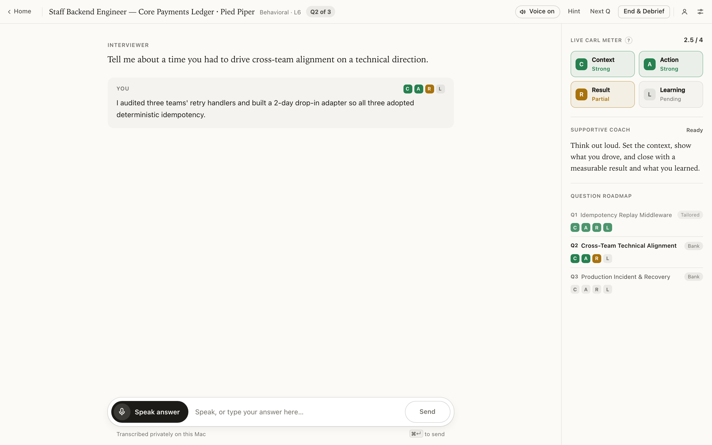
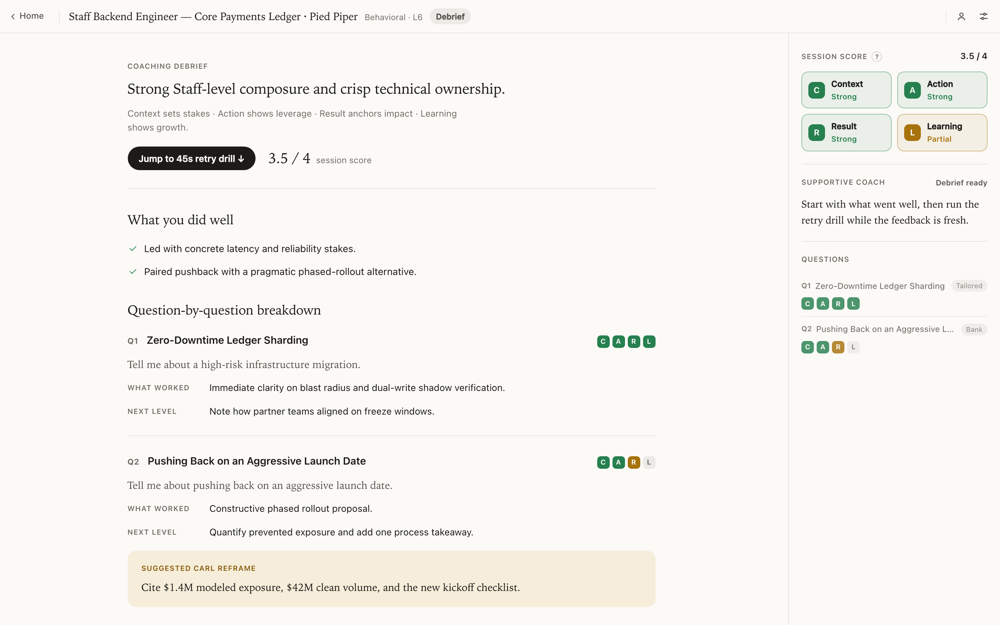
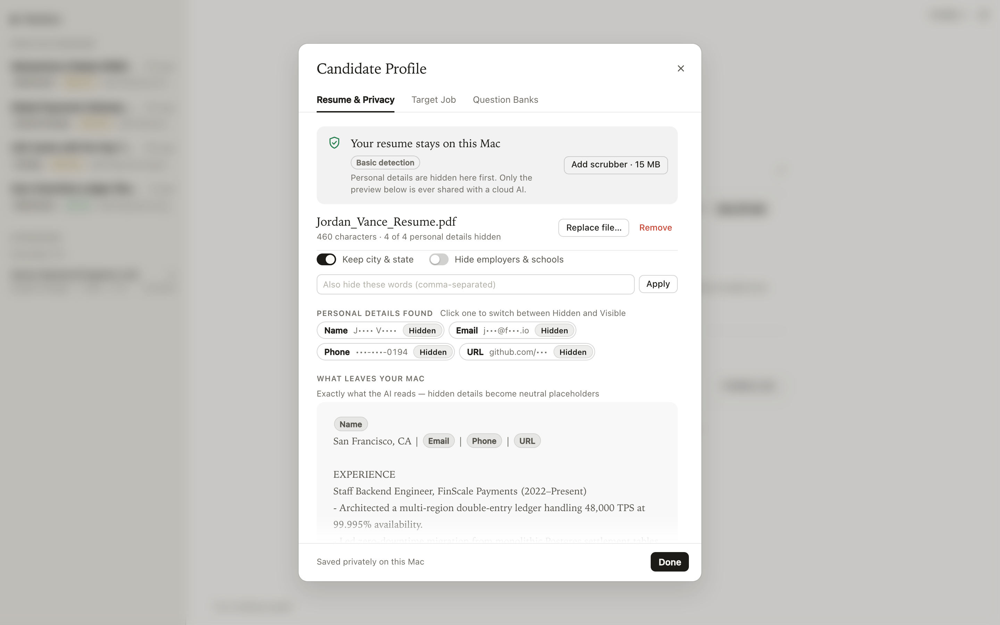

<p align="center">
  <picture>
    <source media="(prefers-color-scheme: dark)" srcset="docs/assets/wordmark-on-dark.svg">
    <source media="(prefers-color-scheme: light)" srcset="docs/assets/wordmark-on-light.svg">
    
  </picture>
</p>

<p align="center">
  <b>A calm, local-first mock interview studio for Apple Silicon.</b><br>
  Practice the interview out loud. Then run one for someone else.
</p>

<p align="center">
  <code>v0.2.0</code> · macOS · Apple Silicon · <a href="LICENSE">MIT</a>
</p>

<p align="center">
  <picture>
    <source media="(prefers-color-scheme: dark)" srcset="docs/assets/hero-dark.png">
    <source media="(prefers-color-scheme: light)" srcset="docs/assets/hero-light.png">
    
  </picture>
</p>

```bash
curl -fsSL https://raw.githubusercontent.com/manthedan/mockery/main/install.sh | sh
```

Mockery has two modes that share one studio. Speech recognition, speaker separation, the interviewer's voice, resume redaction and code execution all run on your Mac. The only thing that can leave is text, and only to a model you chose.

## Two modes

### AI Mock Practice: you're the candidate

A solo interviewer that asks, listens and follows up, shaped by your resume and the job you're aiming for.

- **Voice-first behavioral.** Answer out loud. A live CARL meter tracks Context, Action, Result and Learning as you speak.
- **Debrief and 45-second retry.** A question-by-question breakdown with a suggested reframe, then one timed redo of the answer that needs it most.
- **System design whiteboard.** Sketch clients, gateways, services, stores and queues on an SVG canvas. The interviewer asks about what you actually drew.
- **Coding studio.** Run real tests in an isolated Web Worker. JavaScript is built in; Python runs offline through a local Pyodide pack.
- **Resume privacy redaction.** Names, emails, phone numbers and links are found on-device and swapped for placeholders. The preview is the only version a cloud model can read.

### Live Interviewer Copilot: you're the interviewer

A quiet second pair of ears for the mock you run for a friend or teammate.

- **Offline speech-to-text.** [Parakeet TDT 0.6B v2](https://huggingface.co/mlx-community/parakeet-tdt-0.6b-v2) on MLX. Drafts appear in about 50 ms and lock in with full context.
- **Two voices, kept apart.** On Google Meet, your mic (`You`) and the Chrome tab (`Candidate`) are captured on a shared audio clock with echo-bleed suppression. In person, [WeSpeaker](https://huggingface.co/Wespeaker/wespeaker-voxceleb-resnet34-LM) acoustic diarization on CoreML separates two speakers on one microphone.
- **Live follow-up probes.** Press <kbd>D</kbd> for three follow-ups grounded in what the candidate just said. <kbd>1</kbd>–<kbd>3</kbd> marks them asked, <kbd>N</kbd> starts a new card.
- **Blind calibration.** Lock in your own hire signal, level and rationale first. Then read an audit of that call against the transcript, with every claim cited to its `[MM:SS]` moment.
- **Export.** An interviewer debrief or a scrubbed candidate copy, in Markdown.

## Screens

Real screens from v0.2, captured from the running app with synthetic demo data. They follow your GitHub theme.

<table>
  <tr>
    <td width="50%" valign="top">
      <picture>
        <source media="(prefers-color-scheme: dark)" srcset="docs/assets/screenshots/04_behavioral_dark.png">
        <source media="(prefers-color-scheme: light)" srcset="docs/assets/screenshots/04_behavioral_light.png">
        
      </picture>
      <br><b>Behavioral.</b> Answer out loud while the CARL meter fills in.
    </td>
    <td width="50%" valign="top">
      <picture>
        <source media="(prefers-color-scheme: dark)" srcset="docs/assets/screenshots/07_debrief_dark.png">
        <source media="(prefers-color-scheme: light)" srcset="docs/assets/screenshots/07_debrief_light.png">
        
      </picture>
      <br><b>Debrief and retry.</b> One timed redo while the feedback is fresh.
    </td>
  </tr>
  <tr>
    <td width="50%" valign="top">
      <picture>
        <source media="(prefers-color-scheme: dark)" srcset="docs/assets/screenshots/05_whiteboard_dark.png">
        <source media="(prefers-color-scheme: light)" srcset="docs/assets/screenshots/05_whiteboard_light.png">
        
      </picture>
      <br><b>System design whiteboard.</b> Draw the system while you talk.
    </td>
    <td width="50%" valign="top">
      <picture>
        <source media="(prefers-color-scheme: dark)" srcset="docs/assets/screenshots/06_coding_dark.png">
        <source media="(prefers-color-scheme: light)" srcset="docs/assets/screenshots/06_coding_light.png">
        
      </picture>
      <br><b>Coding studio.</b> Write it, run it, explain it.
    </td>
  </tr>
  <tr>
    <td width="50%" valign="top">
      <picture>
        <source media="(prefers-color-scheme: dark)" srcset="docs/assets/screenshots/02_profile_dark.png">
        <source media="(prefers-color-scheme: light)" srcset="docs/assets/screenshots/02_profile_light.png">
        
      </picture>
      <br><b>Resume privacy redaction.</b> See exactly what leaves your Mac.
    </td>
    <td width="50%" valign="top">
      <picture>
        <source media="(prefers-color-scheme: dark)" srcset="docs/assets/screenshots/09_copilot_calibration_dark.png">
        <source media="(prefers-color-scheme: light)" srcset="docs/assets/screenshots/09_copilot_calibration_light.png">
        
      </picture>
      <br><b>Live Copilot.</b> Your blind call, audited against the transcript.
    </td>
  </tr>
</table>

## Install

> **Requirements:** a Mac with Apple Silicon. Google Chrome is recommended if you want to capture a Google Meet tab.

### One-line installer

Installs `Mockery.app` into Applications:

```bash
curl -fsSL https://raw.githubusercontent.com/manthedan/mockery/main/install.sh | sh
```

Then open **Mockery** from Applications or Spotlight (⌘ Space → `Mockery`).

- It sits in your menu bar and opens the studio at `http://127.0.0.1:8765`.
- On first launch it downloads the offline speech engine once (about 600 MB). After that, transcription works fully offline.
- A welcome screen helps you connect a model, or skip straight to transcript-only.

### Run from source

With [uv](https://docs.astral.sh/uv/):

```bash
git clone https://github.com/manthedan/mockery.git
cd mockery
uv run mockery
```

To build a double-clickable `.app` or `.dmg` locally:

```bash
uv run python scripts/build_macos_app.py --install   # installs /Applications/Mockery.app
uv run python scripts/build_macos_app.py --dmg       # creates dist/Mockery-macOS-arm64.dmg
```

## Bring your own model

Transcription, speaker separation, cards, talk ratios and Markdown export need no key at all. Add a model when you want the practice interviewer, follow-up probes, coaching and calibration.

| Option | Cost and sign-in | Best for |
| --- | --- | --- |
| **Local CLIs** (`claude`, `codex`, `gemini`, `agy`, `pi`) | Your existing subscription. No API key. | One click. Detected automatically if installed. |
| **Google Gemini API** | Free tier through [Google AI Studio](https://aistudio.google.com/apikey). | The easiest cloud setup without a credit card. |
| **Anthropic, OpenAI, DeepSeek, OpenRouter** | Bring your own API key. | Your favourite frontier or budget model. |
| **[oMLX](https://github.com/jundot/omlx), Ollama, LM Studio** | Free and fully offline. | Private local models. Lists what you have loaded. A 16 GB Mac or larger is recommended. |
| **Transcript-only** | Free. Zero setup. | Pure local transcription, notes and export. |

Use **Settings → Test connection** to check your setup before an interview.

## What runs where

| On your Mac, always | What it is |
| --- | --- |
| Speech-to-text | Parakeet TDT 0.6B on MLX. Downloaded once, then offline. |
| Speaker separation | WeSpeaker on CoreML. Two speakers from one microphone. |
| Interviewer voice | Optional Kokoro or Phonon neural voice packs. The built-in macOS voice works with nothing installed. |
| Resume redaction | Optional Rampart on-device model (about 15 MB). Basic detection is built in. |
| Code runner | Web Worker sandboxes. JavaScript built in, Python through a local Pyodide pack. |
| Your sessions | Plain files in `~/Library/Application Support/Mockery` (or the checkout, when run from source). |

The model you bring only ever receives text: what was said, what you typed or drew, and the redacted resume preview you approved. Audio never leaves your machine. With oMLX, Ollama or LM Studio, nothing leaves at all.

## Security and privacy

- Mockery binds to `127.0.0.1` by default and verifies same-origin requests.
- If you expose it on a local network on purpose (`mockery --host 0.0.0.0`), it requires a cryptographically random access token, or one you pass with `--lan-token <secret>`.
- API keys are saved locally in `.env.local` with `0600` permissions and are sent only to the provider you chose.
- Saved transcripts live in `~/Library/Application Support/Mockery/sessions` (or `./sessions` inside a git checkout). **Settings → Reveal in Finder** opens the folder.

## Speech language

Mockery defaults to `parakeet-tdt-0.6b-v2` for the fastest, cleanest English transcription. For another language, open **Settings → Speech model** and switch to `parakeet-tdt-0.6b-v3` (25 European languages).

## Development

```bash
uv run python scripts/check.py        # ruff, architecture lint, JS syntax, unit + FSM + fuzz tests
uv run python scripts/check.py --ui   # adds browser UAT and the property-based UI explorer
uv run pytest -v
```

State machine introspection:

```bash
uv run mockery --dump-machines   # JSON + Mermaid diagrams
# HTTP: GET /api/machines
# Browser console: window.__MOCKERY_STATE__
```

- [`docs/feature-map.md`](docs/feature-map.md) maps every surface to its DOM landmarks, modules and routes.
- [`docs/state-charts.md`](docs/state-charts.md) holds the generated state charts.

### Release site and marketing assets

[`site/`](site/) is the release landing page: static, zero build, self-contained for GitHub Pages. Shared brand and screenshot assets live in [`docs/assets/`](docs/assets/). Everything is regenerated from the running app with synthetic demo data:

```bash
uv run python scripts/verify_ui.py snapshots --out-dir docs/assets/screenshots
uv run --with pillow python docs/marketing/render_assets.py all   # Copilot screens, PNG renders, site/assets
uv run python docs/marketing/verify_site.py                       # headless Chrome: desktop + mobile, dark + light
python3 -m http.server --bind 127.0.0.1 --directory site 8080     # preview at http://127.0.0.1:8080
```

The launch video blueprint is in [`docs/marketing/video-brief.md`](docs/marketing/video-brief.md).

## License

[MIT](LICENSE)
