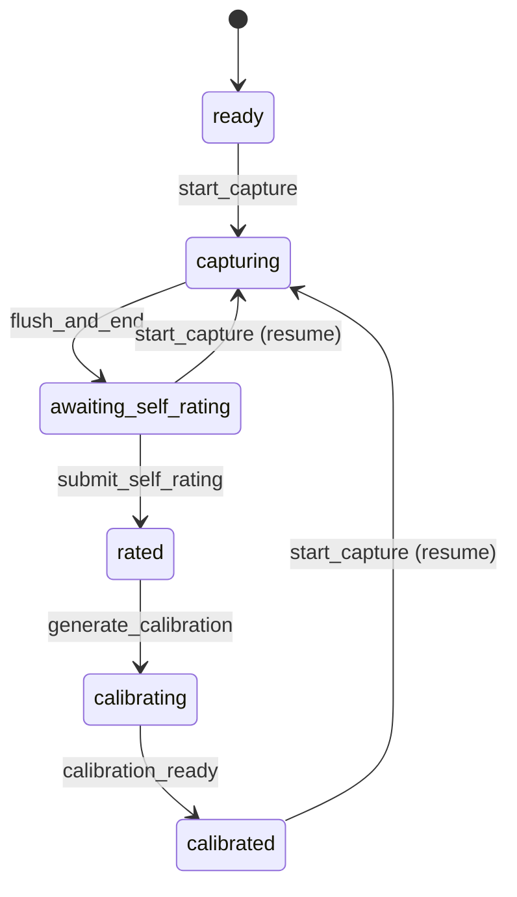
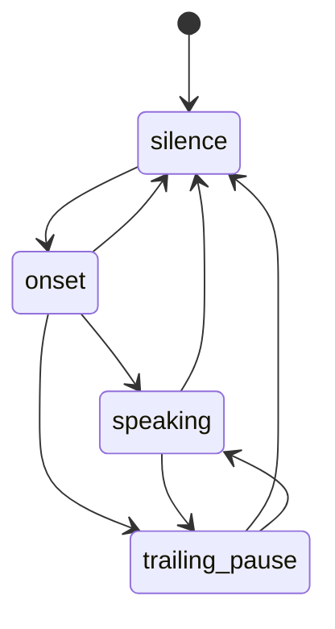
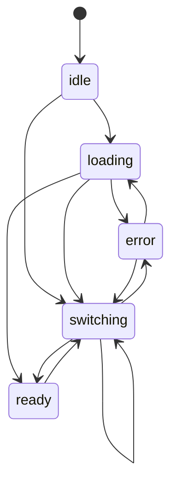
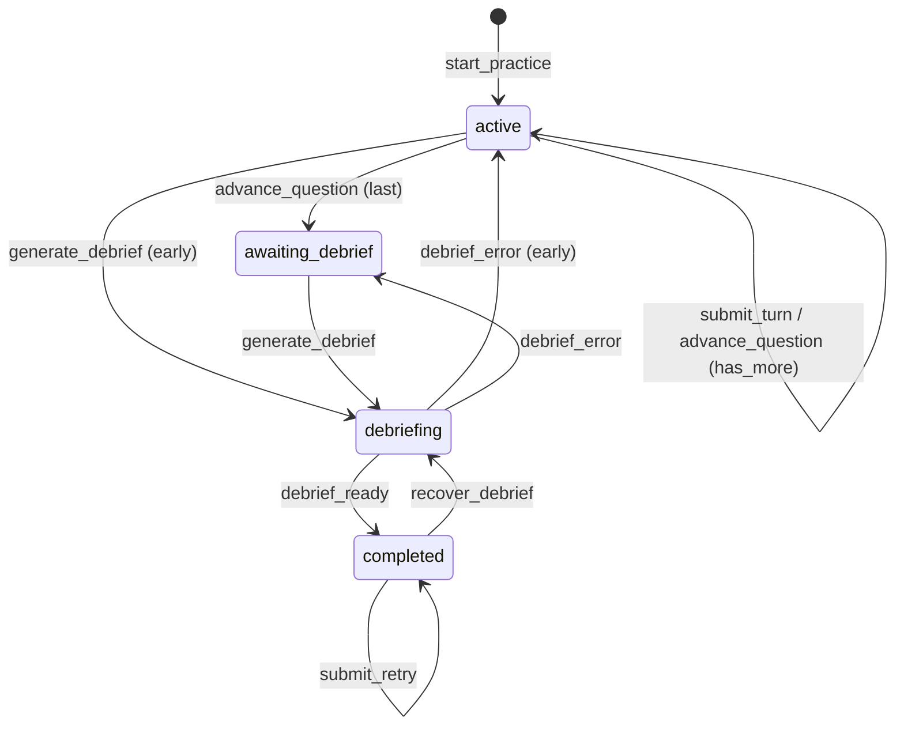
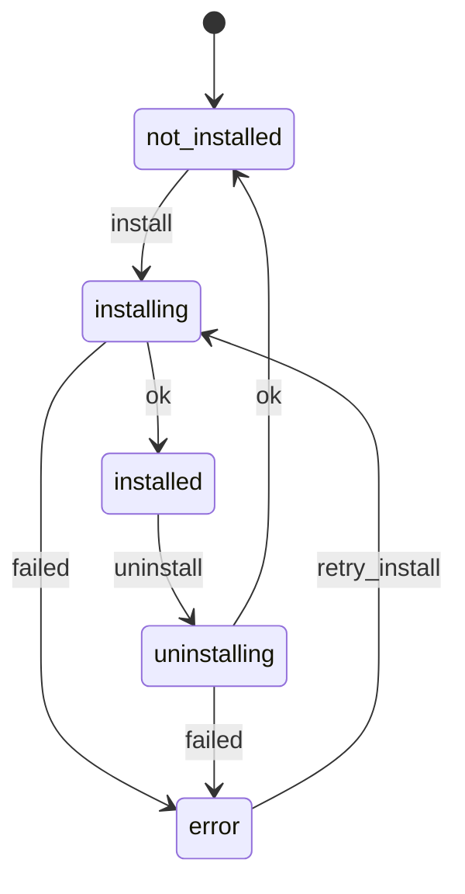
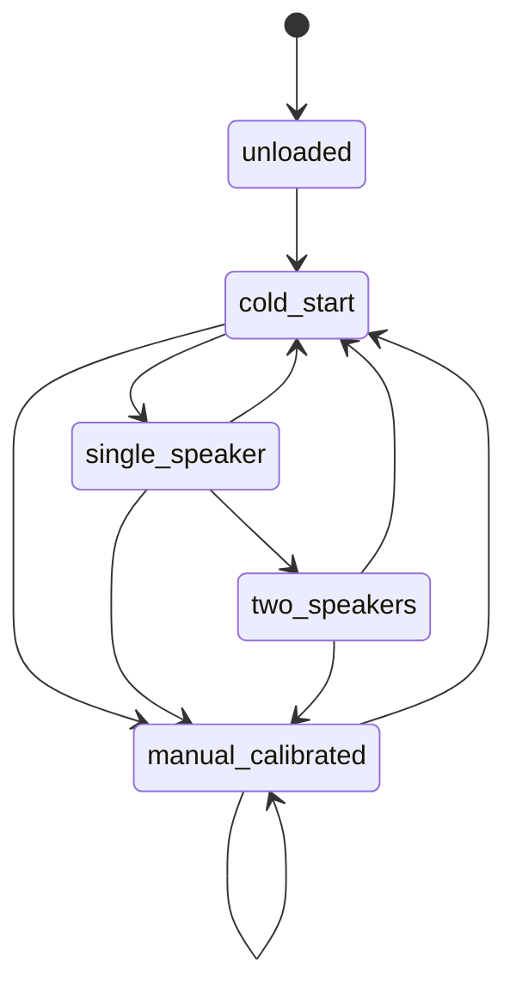
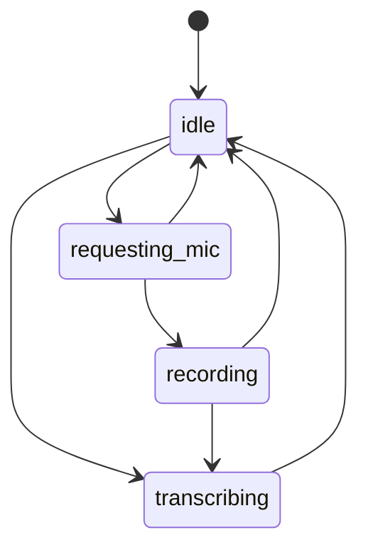
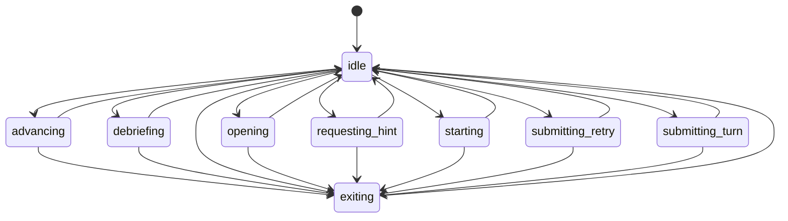
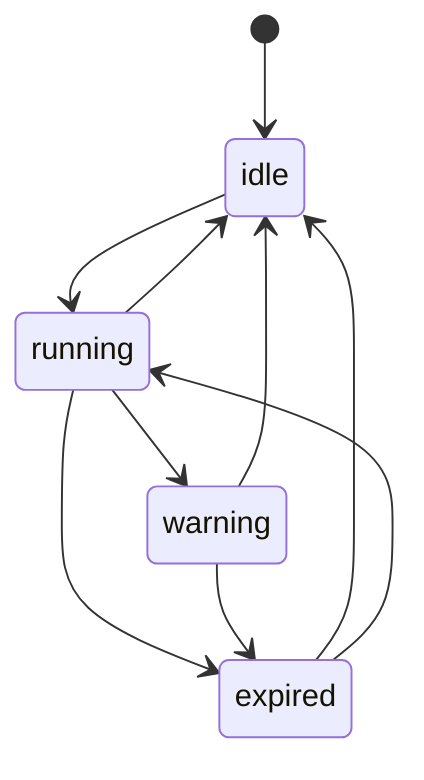
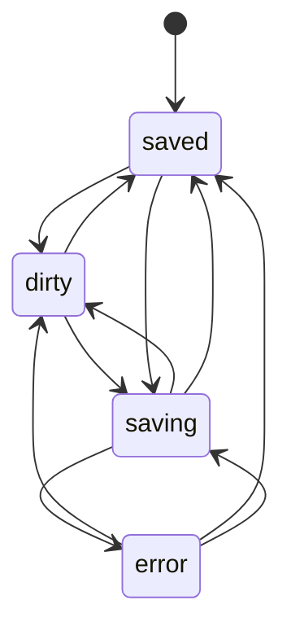

# Mockery State Charts (Auto-Generated)

Generated directly from `src/mockery/state_machines.py` and `src/mockery/static/state_machines.js`.
Do not edit manually — regenerate with `uv run python scripts/lint_arch.py --write-charts`.

## Backend State Machines (`src/mockery/state_machines.py`)

### `session_phase`

### `vad_turn`

### `asr_model`

### `practice_phase`

### `addon_pack`

### `diarizer_enrollment`

## Frontend Client State Machines (`src/mockery/static/state_machines.js`)

### `practice_mic`

### `practice_op`

### `practice_retry_timer`

### `practice_workspace_save`

